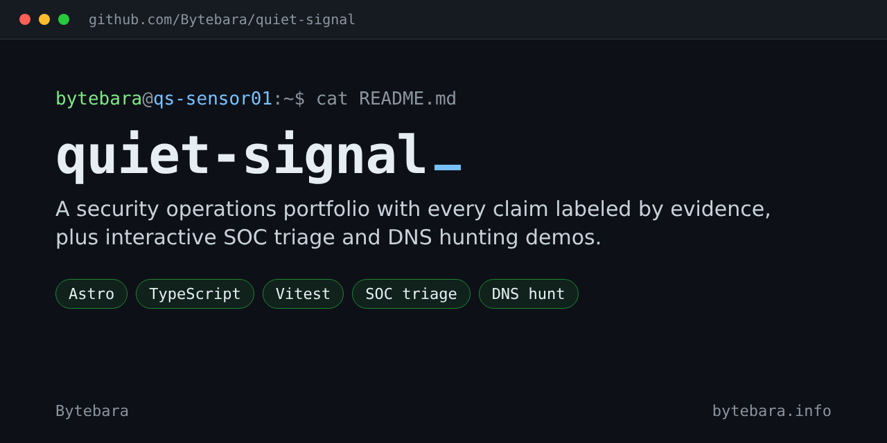
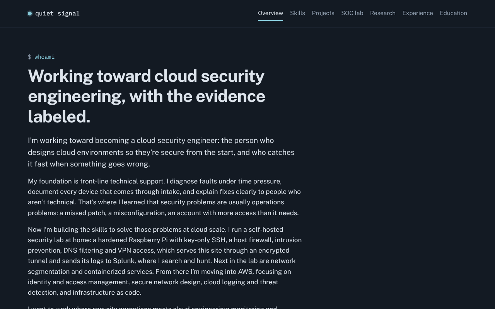
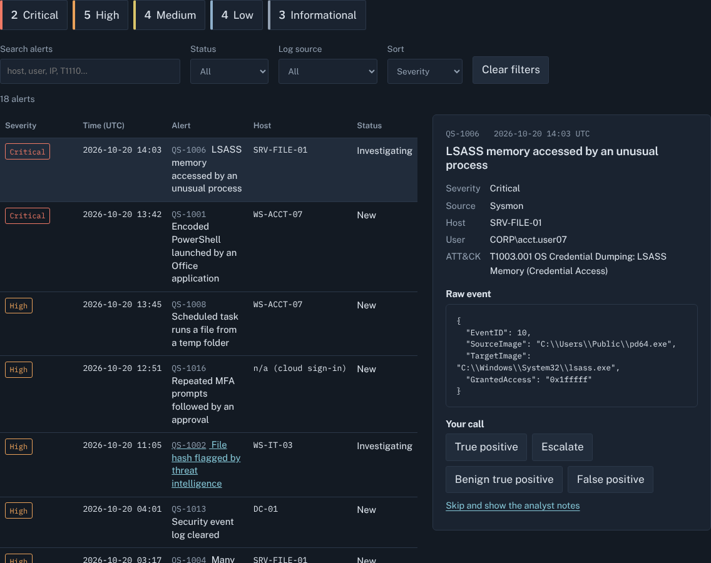
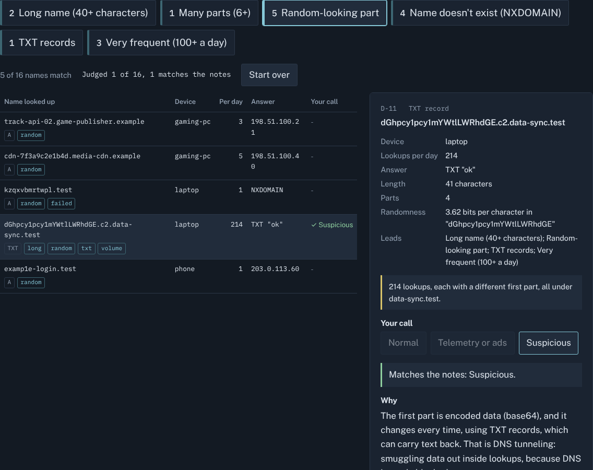

[](https://github.com/Bytebara/quiet-signal/actions/workflows/ci.yml)
[](https://bytebara.info)

My security operations portfolio. Most portfolios say what someone knows; this one also says **how much weight each claim deserves**. Every skill, project and write-up carries one label:

| Label | Meaning |
|---|---|
| **Applied** | Used in a job or completed coursework |
| **Explored** | Set up or worked through hands-on |
| **Learning** | Currently studying |
| **Simulated** | Runs on synthetic data made for demonstration |
| **Planned** | On the roadmap; nothing to show yet |

**Live:** [bytebara.info](https://bytebara.info)



## Try it

**[SOC alert triage](https://bytebara.info/soc-lab/).** A queue of eighteen synthetic alerts written to resemble Sysmon, Windows Security, proxy and identity-provider events. Open one, read the raw event, make your call, then compare it with the analyst notes. Several alerts are connected.



**[DNS hunt](https://bytebara.info/dns-hunt/).** A day of Pi-hole-style lookups from a made-up home network. Turn on hunting leads (long names, random-looking labels, NXDOMAIN, TXT, volume), investigate each name and judge it. Every lead also catches something harmless, on purpose; the suspicious device only stands out when several signs line up.



## Built to be private and safe

- **No cookies, analytics, trackers, forms or third-party requests.** Fonts are self-hosted; visitors' browsers only ever talk to this site.
- **A strict Content-Security-Policy:** same-origin scripts and styles only, no inline code, no outbound connections.
- **No `innerHTML`.** The demos build every element with `textContent`, so data can never become markup. Search input is type-checked, cleaned and length-capped.
- **Synthetic data stays synthetic.** Tests check that every IP comes from the documentation ranges and every domain from the reserved example names.
- **A privacy scanner** runs in CI on every push: it checks files, image metadata and every commit identity in the history for personal details.

## Under the hood

[Astro](https://astro.build) builds a static site from pages and Markdown; TypeScript runs the demos; [Vitest](https://vitest.dev) tests the logic behind them; GitHub Actions runs the type check, tests, build and privacy scan. The site is published on GitHub Pages and on my own Raspberry Pi behind a Cloudflare Tunnel (see [home-soc-lab](https://github.com/Bytebara/home-soc-lab)).

```bash
npm install
npm run dev      # http://localhost:4321
npm run verify   # type check, tests, build, privacy scan
```

Everything else (project layout, common edits, publishing, the privacy checklist and the security choices in detail) is in [docs/DEVELOPING.md](docs/DEVELOPING.md).

---

Published under a project name, with no personal contact details by design.
